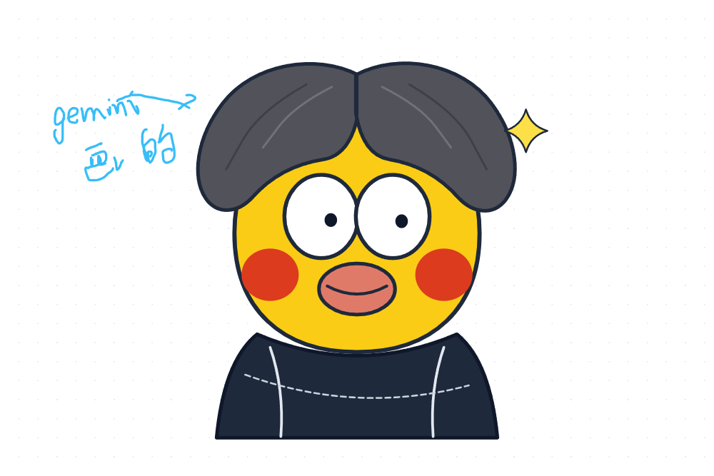

# Liquid Canvas — Antigravity 液态玻璃智能协作画板插件

一款专为 **Antigravity** 打造的交互式液态玻璃画板插件（MCP App），支持**智能体（Agent）**与**用户**在同一块实时画布上共同绘画、识图理解与精细修改。

## 核心特性

- **液态玻璃极简 UI（Liquid Glass）**
  - 多层半透明磨砂玻璃悬浮胶囊栏（`backdrop-filter: blur(24px) saturate(190%)`）、高光顶边与环境流体光晕，并随 Antigravity 深色 / 浅色主题自动切换。
  - 极简三组悬浮控件（左上画板切换与撤销重做、右上图层/设置/导出/AI 协作、底部工具坞与上下文样式胶囊），将近 90% 空间留给画布创作。
- **用户自由绘画与编辑**
  - 画笔（平滑二次贝塞尔曲线）、荧光 / 霓虹发光笔、矩形 / 液态玻璃卡片、圆形、箭头、直线、画布原地文字编辑（`T`）、智能橡皮擦（`E`）。
  - 选择工具支持框选多选、拖拽移动、8 向缩放、置顶/置底、复制、删除、快捷键（`V/H/P/M/R/O/A/L/T/E`、`Ctrl+Z`/`Ctrl+Shift+Z`、`Space` 拖拽平移、滚轮缩放、`Ctrl+V` 粘贴图片）。
  - 支持 `.lcanvas` 画板工程文件的直接打开与保存。
- **智能体协同绘画与修改**
  - `open_canvas`：在侧边栏（`aux_pane`）或左栏全屏（`global`）打开画板并实时同步刷新。
  - `get_canvas`：同时返回画板元素的结构化坐标/ID 清单与实时渲染的 PNG 图像，让智能体真正看懂用户的手绘草图并精准修改。
  - `draw_elements` / `update_elements` / `delete_elements` / `manage_layers` / `board_action`：支持批量绘图（渐变、液态玻璃卡片、曲线箭头、SVG 路径、多图层、撤销重做、导出 SVG/PNG）。

## 目录结构

```text
liquid-canvas/
├── plugin.json                      # Antigravity 插件清单
├── mcp_config.json                  # MCP Server 配置 (使用 Antigravity 内置 Node 运行)
├── README.md                        # 本说明文档
├── LICENSE                          # 项目许可证
├── assets/logo.svg                  # 插件图标
├── dist/board.html                  # 已构建的单文件 MCP App 前端界面
├── server/
│   ├── index.mjs                    # MCP stdio 服务端与工具/资源路由
│   ├── store.mjs                    # 画布文档模型、图层、撤销重做与持久化
│   └── renderer.mjs                 # SVG 导出器与纯 Node PNG 光栅化兜底渲染器
├── skills/liquid-canvas/SKILL.md    # 智能体协作绘画指南技能
├── ui/                              # 前端源码与打包好的 @modelcontextprotocol/ext-apps SDK
├── scripts/
│   ├── build.mjs                    # 构建 dist/board.html
│   └── install.ps1                  # Windows 一键安装到 Antigravity 插件目录
├── showcase/                        # 项目展示作品（PNG / SVG / .lcanvas）
└── tests/                           # 单元测试与端到端 MCP 协议测试
```

## 安装与使用

### 方式一：Windows 一键安装

在源码根目录运行：

```powershell
powershell -NoProfile -ExecutionPolicy Bypass -File .\scripts\install.ps1
```

安装脚本会自动构建 `dist/board.html` 并将插件运行时文件安装到 `%USERPROFILE%\.gemini\config\plugins\liquid-canvas`。

### 方式二：跨平台手动安装

本仓库已包含预构建好的 `dist/board.html`。将 `plugin.json`、`mcp_config.json`、`README.md`、`LICENSE`、`assets/`、`dist/`、`server/` 和 `skills/` 复制到 `~/.gemini/config/plugins/liquid-canvas/`。同时将 `ui/vendor/` 下的 `EXT_APPS_LICENSE.txt` 和 `THIRD_PARTY_NOTICES.txt` 复制到插件目录中的同名路径。Antigravity 会自动发现并热加载插件。

### 开发与测试

```powershell
# 重新构建单文件 UI 资产
node scripts/build.mjs

# 运行全套测试（store / renderer / MCP 协议闭环）
node --test tests/*.test.mjs
```

## 项目展示

[showcase/](showcase/) 目录包含智能体与用户在同一画布上协同绘制的示例作品：

- [collaborative-sketch.png](showcase/collaborative-sketch.png) — 实时画布导出 PNG 预览
- [collaborative-sketch.svg](showcase/collaborative-sketch.svg) — 矢量 SVG 导出
- [collaborative-sketch.lcanvas](showcase/collaborative-sketch.lcanvas) — 可直接在 Antigravity 中打开并继续编辑的工程文件



## 许可证

Liquid Canvas 项目代码采用 MIT 许可证。 [查看许可证](LICENSE)

随前端分发的 MCP Apps SDK 及其依赖适用各自的许可证。 [MCP Apps SDK 许可证](ui/vendor/EXT_APPS_LICENSE.txt) · [第三方组件声明](ui/vendor/THIRD_PARTY_NOTICES.txt)
